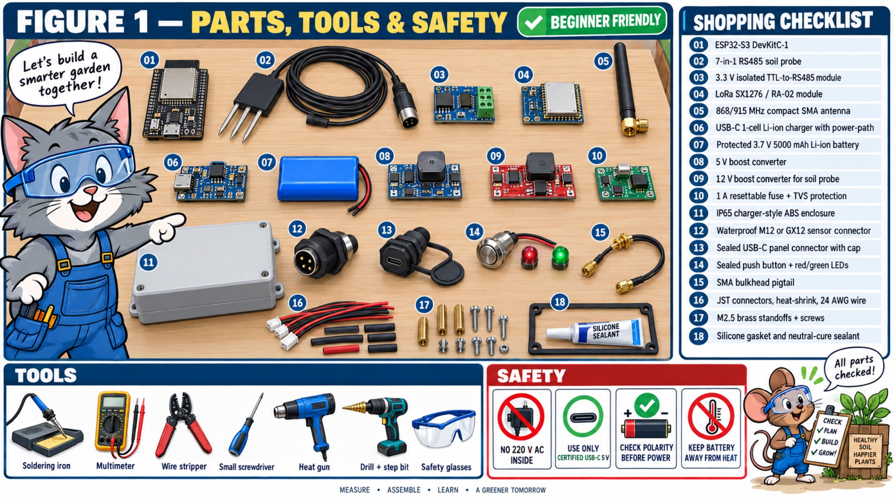
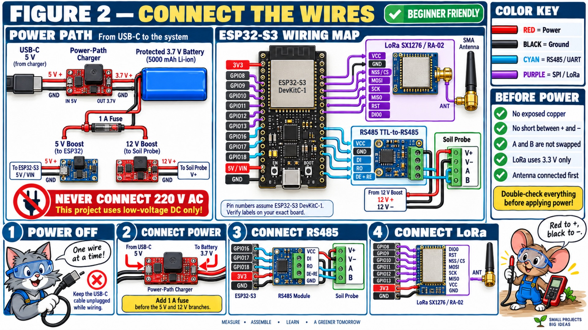
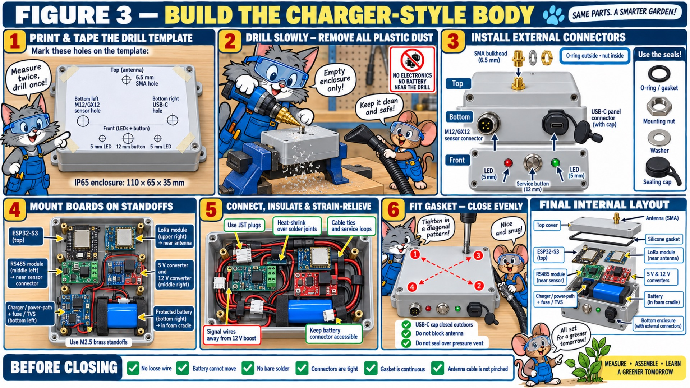
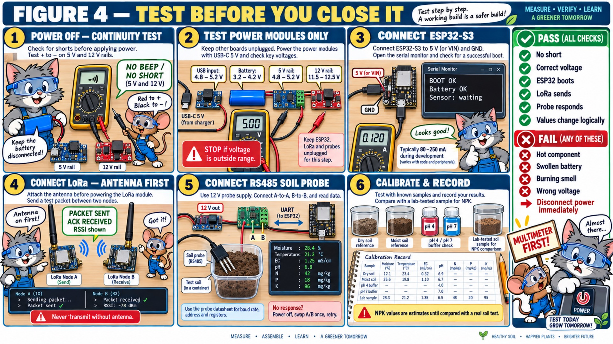
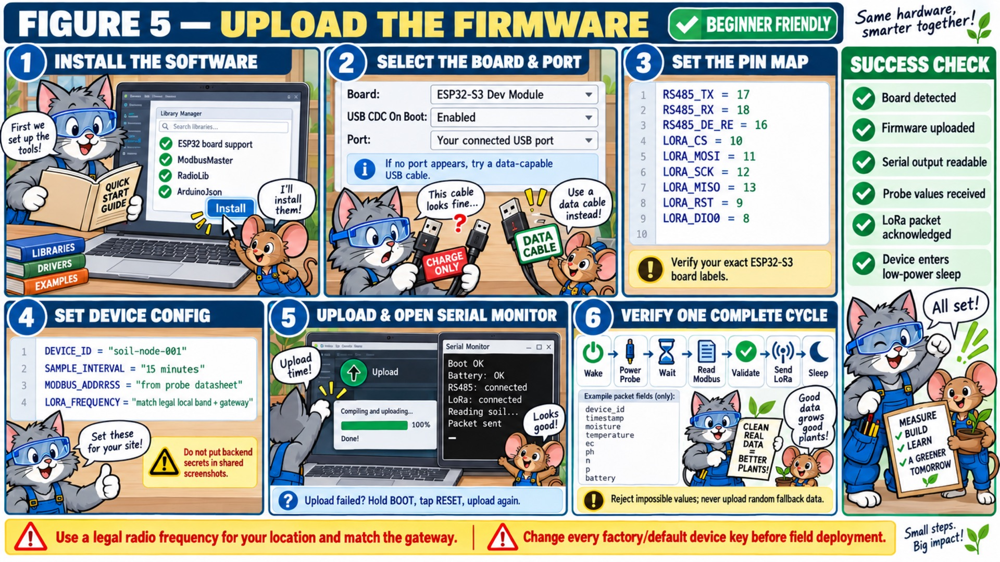
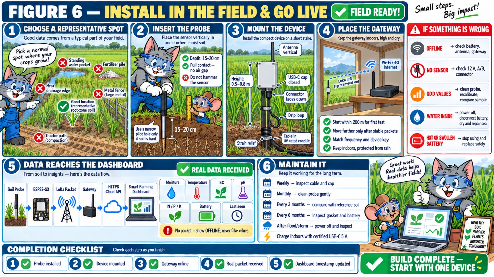

# Compact Smart Soil Device — Beginner Build Guide

এই guide-টি charger-shaped, battery-powered soil-monitoring prototype তৈরির জন্য। Base device শুধু soil data সংগ্রহ ও LoRa-তে পাঠাবে। Irrigation valve base device-এর অংশ নয়।

> গুরুত্বপূর্ণ: ছবির ছোট label-এর চেয়ে এই document-এর wiring table authoritative। কোনো module-এর printed label বা datasheet এই guide-এর সঙ্গে না মিললে কাজ বন্ধ করে datasheet অনুসরণ করুন।

## প্রথমে নিরাপত্তা

- এই device-এ কখনো `220 V AC` ঢোকাবেন না।
- কেবল certified `USB-C 5 V` adapter দিয়ে charge করবেন।
- Outdoor অবস্থায় charge করবেন না; device শুকনো জায়গায় এনে charge করুন।
- Battery ফুলে গেলে, গরম হলে, গন্ধ হলে বা puncture হলে ব্যবহার বন্ধ করুন।
- Battery লাগানো অবস্থায় enclosure drill করবেন না।
- Multimeter ছাড়া প্রথমবার power দেবেন না।
- Wiring করার সময় battery ও USB cable দুটোই খুলে রাখবেন।
- Probe-এর wire color বিশ্বাস করবেন না; vendor datasheet-এর `V+`, `V−`, `A`, `B` pin শনাক্ত করুন।

## Device-এর সহজ flow

```text
Soil probe
   ↓ RS485
ESP32-S3
   ↓ SPI
LoRa module → LoRa gateway → Internet → Cloud API → Smart Farming dashboard
```

Power flow:

```text
USB-C 5 V → power-path charger → protected 1S battery
                                      ├→ 5 V boost → ESP32-S3
                                      └→ 12 V boost → soil probe
```

---

## Figure 1 — Parts, tools and safety



### প্রয়োজনীয় parts

| No. | Component | কী কাজ করবে | কেনার সময় কী দেখবেন |
|---:|---|---|---|
| 01 | ESP32-S3 DevKitC-1 বা equivalent | Main controller | USB port ও প্রয়োজনীয় GPIO exposed থাকতে হবে |
| 02 | 7-in-1 RS485 soil probe | Moisture, temperature, EC, pH, N, P, K | 9–24 V/12 V support, Modbus RTU datasheet |
| 03 | 3.3 V isolated TTL-to-RS485 module | ESP32 ও long sensor cable-এর data interface | `DI`, `RO`, `DE`, `RE`, `A`, `B` pin থাকতে হবে |
| 04 | SX1276/RA-02 LoRa module | Long-range radio | Gateway-এর legal frequency band-এর সঙ্গে মিলতে হবে |
| 05 | Matching SMA LoRa antenna | Radio signal | LoRa module-এর frequency version-এর সঙ্গে matching |
| 06 | USB-C 1S Li-ion power-path charger | Charge করার সময় safe power routing | BQ24074 বা equivalent real load-sharing/power-path |
| 07 | Protected 3.7 V 5000 mAh battery | Portable power | Built-in protection ও JST connector; bare cell নয় |
| 08 | Adjustable 5 V boost converter | ESP32 VIN power | আগে multimeter দিয়ে 5.0 V set করতে হবে |
| 09 | Adjustable 12 V boost converter | Soil probe power | আগে multimeter দিয়ে 12.0 V set করতে হবে |
| 10 | 1 A resettable fuse/PTC + TVS | Short/surge protection | System current অনুযায়ী rated |
| 11 | IP65 ABS enclosure | Charger-style body | আনুমানিক 110 × 65 × 35 mm; parts বসে কি না আগে মাপুন |
| 12 | M12/GX12 waterproof connector | Probe detachable connection | অন্তত 4 pin: V+, V−, A, B |
| 13 | Sealed USB-C panel connector | Outdoor charging port | Rubber cap ও gasket থাকতে হবে |
| 14 | Sealed button + LEDs | Service/reset/status | Outdoor-rated panel parts |
| 15 | SMA bulkhead pigtail | Internal LoRa-to-antenna link | RA-02 connector type-এর সঙ্গে মিলতে হবে |
| 16 | JST plugs, 24 AWG wire, heat-shrink | Internal wiring | Power-এর জন্য red/black, signal-এর জন্য আলাদা color |
| 17 | M2.5 standoffs/screws | Boards securely mount করা | Plastic বা brass; enclosure depth অনুযায়ী |
| 18 | Silicone gasket/sealant | Water resistance | Electronics-safe neutral-cure silicone |

### Tools

- Temperature-controlled soldering iron
- Multimeter
- Wire stripper/cutter
- Small screwdriver set
- Heat gun
- Drill ও step bit
- Safety glasses
- Helping hands বা PCB holder
- Label tape/marker

### কেনার আগে অবশ্যই যাচাই

1. Soil probe-এর datasheet সংগ্রহ করুন।
2. Probe voltage, Modbus baud rate, slave address এবং register table নিশ্চিত করুন।
3. LoRa module ও gateway একই frequency variant কি না যাচাই করুন।
4. সব parts কাগজের উপর সাজিয়ে enclosure-এর ভিতরে physically fit করে কি না দেখুন।
5. Generic `TP4056` module সাধারণত proper power-path নয়। Device charge চলাকালে চালাতে চাইলে proper load-sharing board নিন।

---

## Figure 2 — Exact wiring



### Step A — Power wiring

Power disconnected অবস্থায় wire করুন।

| From | To | Wire |
|---|---|---|
| USB-C panel `5V` | Power-path charger `IN+` | Red |
| USB-C panel `GND` | Power-path charger `IN−/GND` | Black |
| Charger `BAT+` | Protected battery `+` | Red/JST |
| Charger `BAT−` | Protected battery `−` | Black/JST |
| Charger/system output `+` | 1 A fuse/PTC input | Red |
| Fuse output | 5 V boost `IN+` এবং 12 V boost `IN+` | Red split |
| System ground | দুই boost converter-এর `IN−` | Black |
| 5 V boost `OUT+` | ESP32 `5V/VIN` | Red |
| 5 V boost `OUT−` | ESP32 `GND` | Black |
| 12 V boost `OUT+` | Probe `V+` | Red |
| 12 V boost `OUT−` | Probe `V−` | Black |

`5 V boost` ও `12 V boost` ESP32/probe লাগানোর আগেই multimeter দিয়ে set করুন।

### Step B — ESP32 থেকে RS485 module

এই pin map ESP32-S3 DevKitC-1-এর একটি proposed map। Exact board label যাচাই করুন।

| ESP32-S3 | RS485 module | কাজ |
|---|---|---|
| `GPIO17 / TX` | `DI` | ESP32 থেকে probe data |
| `GPIO18 / RX` | `RO` | Probe থেকে ESP32 data |
| `GPIO16` | `DE` এবং `RE` একসঙ্গে | Transmit/receive direction |
| `3V3` | Logic-side `VCC` | Module logic power |
| `GND` | Logic-side `GND` | Logic ground |
| RS485 `A` | Probe `A` | Differential data A |
| RS485 `B` | Probe `B` | Differential data B |

যদি আপনার isolated module `5 V VCC` চায়, তার datasheet অনুসরণ করুন। ESP32 GPIO-তে কখনো 5 V logic ফেরত আসতে দেবেন না।

### Step C — ESP32 থেকে LoRa RA-02

| ESP32-S3 | LoRa SX1276/RA-02 |
|---|---|
| `GPIO10` | `NSS/CS` |
| `GPIO11` | `MOSI` |
| `GPIO12` | `SCK` |
| `GPIO13` | `MISO` |
| `GPIO9` | `RST` |
| `GPIO8` | `DIO0` |
| `3V3` | `VCC` |
| `GND` | `GND` |
| LoRa `ANT` | SMA pigtail → antenna |

LoRa module-এ শুধু `3.3 V` দেবেন। Power দেওয়ার আগে antenna লাগান।

### Optional battery measurement

Battery percentage dashboard-এ দেখাতে চাইলে battery positive থেকে `100 kΩ` resistor, তারপর `GPIO4`, তারপর আরেকটি `100 kΩ` resistor দিয়ে GND-তে voltage divider করা যায়। GPIO4 থেকে GND-তে `100 nF` capacitor দিলে reading স্থির হয়। Firmware-এ divider ratio ও ADC calibration প্রয়োগ করতে হবে। এটি না বুঝলে প্রথম prototype-এ বাদ দিন।

### Wiring শেষ হওয়ার পর

- প্রতিটি wire দুবার trace করুন।
- Connector pin number লিখে রাখুন।
- Heat-shrink ব্যবহার করুন।
- LoRa antenna cable ও boost converter দূরে রাখুন।
- Probe/data cable এবং noisy 12 V boost wiring parallelভাবে লম্বা দূরত্বে চালাবেন না।

---

## Figure 3 — Charger-style body assembly



### Enclosure কাটার আগে

1. Actual connector-এর thread diameter caliper দিয়ে মাপুন।
2. Paper drill template বানান।
3. খালি enclosure-এর উপর tape দিয়ে template লাগান।
4. সব parts আবার dry-fit করুন।

### Suggested placement

- Top: SMA antenna bulkhead
- Bottom-left: soil-probe connector
- Bottom-right: capped USB-C connector
- Front: red/green LED এবং service button
- ভিতরে top: ESP32-S3
- Antenna-এর কাছে: LoRa module
- Sensor connector-এর কাছে: RS485 module
- মাঝখানে: 5 V ও 12 V converters
- নিচে: charger board, fuse/TVS এবং foam cradle-এ battery

### Drill ও assembly order

1. Battery ও electronics সম্পূর্ণ সরান।
2. Enclosure clamp করুন এবং safety glasses পরুন।
3. ছোট pilot hole দিয়ে শুরু করুন।
4. Step bit দিয়ে অল্প অল্প করে hole বড় করুন।
5. Plastic dust সম্পূর্ণ পরিষ্কার করুন।
6. Connector-এর O-ring বাইরে, washer/nut ভিতরে দিন।
7. Board-এর নিচে standoff ব্যবহার করুন; PCB সরাসরি enclosure-এ ঠেকাবেন না।
8. Solder joint-এ heat-shrink দিন।
9. Wire-এর service loop রাখুন, কিন্তু loose coil করবেন না।
10. Battery-কে foam cradle/strap দিয়ে আটকান; battery-তে screw বা glue দেবেন না।
11. Gasket একটানা বসান।
12. Cover screw diagonal X pattern-এ অল্প অল্প করে tighten করুন।

### Waterproofing-এর গুরুত্বপূর্ণ কথা

- IP65 enclosure কিনলেই final device স্বয়ংক্রিয়ভাবে IP65 হয় না। প্রতিটি hole/connector/gasket সঠিকভাবে seal করতে হবে।
- Neutral-cure silicone ব্যবহার করুন; acidic-smelling bathroom silicone electronics ক্ষতি করতে পারে।
- Pressure vent থাকলে sealant দিয়ে বন্ধ করবেন না।
- পানিতে ডুবিয়ে test করবেন না। প্রথমে tissue/paper রেখে controlled spray test করুন, electronics ছাড়া।

---

## Figure 4 — Power-on, sensor test and calibration



### Test 1 — Power-off continuity

1. Battery ও USB খুলে রাখুন।
2. Multimeter continuity mode করুন।
3. 5 V `+` থেকে GND test করুন। স্থায়ী beep হওয়া উচিত নয়।
4. 12 V `+` থেকে GND test করুন। স্থায়ী beep হওয়া উচিত নয়।
5. Beep হলে power দেবেন না; short খুঁজুন।

### Test 2 — শুধু power modules

ESP32, LoRa ও probe খুলে রেখে power section চালু করুন।

| Test point | Acceptable initial target |
|---|---:|
| USB input | 4.8–5.2 V |
| Battery | আনুমানিক 3.2–4.2 V |
| ESP32 rail | 4.8–5.2 V |
| Probe rail | 11.5–12.5 V |

Range-এর বাইরে হলে বন্ধ করুন এবং converter adjust/repair করুন।

### Test 3 — ESP32 boot

1. শুধু ESP32 connect করুন।
2. Data-capable USB cable দিয়ে computer-এ লাগান।
3. Serial monitor-এ boot message দেখুন।
4. কোনো component দ্রুত গরম হচ্ছে কি না আঙুল না দিয়ে সতর্কভাবে পর্যবেক্ষণ করুন।

### Test 4 — LoRa

1. Antenna লাগান।
2. একই band-এর দ্বিতীয় node বা gateway চালু করুন।
3. Test packet পাঠান।
4. Receiver acknowledgement ও RSSI record করুন।

### Test 5 — RS485 probe

1. Probe-কে test soil-এ সম্পূর্ণ contact করান।
2. Datasheet অনুযায়ী baud rate, parity, slave address ও register set করুন।
3. কোনো response না এলে power off করুন, wiring যাচাই করুন, তারপর A/B একবার swap করে retry করতে পারেন।
4. Value পরিবর্তিত হচ্ছে কি না dry ও moist soil-এ পরীক্ষা করুন।

### Calibration

- Moisture: একই soil-এর dry reference ও known-moist reference নিন।
- Temperature: নির্ভরযোগ্য thermometer-এর সঙ্গে তুলনা করুন।
- EC: standard solution থাকলে যাচাই করুন।
- pH: compatible probe হলে pH 4 ও pH 7 buffer দিয়ে check করুন।
- N/P/K: laboratory-tested soil sample-এর সঙ্গে তুলনা ছাড়া accurate fertilizer decision নেবেন না। Low-cost NPK probe-এর result indicative হিসেবে ধরুন।

---

## Figure 5 — Firmware upload



### Software

- Arduino IDE অথবা PlatformIO
- ESP32 board support
- `ModbusMaster`
- `RadioLib`
- `ArduinoJson`

### Board setup

- Board: `ESP32-S3 Dev Module` বা আপনার exact board
- USB CDC On Boot: Enabled
- Correct USB port
- Charge-only cable নয়; data cable ব্যবহার করুন

### Firmware configuration

```text
RS485_TX      = 17
RS485_RX      = 18
RS485_DE_RE   = 16
LORA_CS       = 10
LORA_MOSI     = 11
LORA_SCK      = 12
LORA_MISO     = 13
LORA_RST      = 9
LORA_DIO0     = 8
```

Device settings:

```text
DEVICE_ID        = soil-node-001
SAMPLE_INTERVAL  = 15 minutes
MODBUS_ADDRESS   = probe datasheet value
LORA_FREQUENCY   = locally legal band matching gateway
```

LoRa frequency ও transmit power স্থানীয় radio regulation অনুযায়ী হতে হবে। Gateway, antenna ও node একই band-এর হতে হবে।

### একটি sensor cycle

```text
Wake
→ probe power on
→ warm-up delay
→ Modbus read
→ range/CRC validation
→ LoRa packet send
→ acknowledgement/status record
→ probe power off
→ deep sleep
```

Suggested packet fields:

```json
{
  "device_id": "soil-node-001",
  "timestamp": "gateway-assigned-or-synchronized",
  "moisture_pct": 0,
  "temperature_c": 0,
  "ec_ms_cm": 0,
  "ph": 0,
  "nitrogen_mg_kg": 0,
  "phosphorus_mg_kg": 0,
  "potassium_mg_kg": 0,
  "battery_v": 0,
  "quality": "valid-or-rejected"
}
```

Impossible/out-of-range value reject করুন। Sensor error হলে random/default value পাঠাবেন না। Backend-এ `offline` বা `invalid` status পাঠান।

Device secret source code বা screenshot-এ রাখবেন না। প্রতিটি device-এর আলাদা key দিন এবং factory/default key deployment-এর আগে পরিবর্তন করুন।

---

## Figure 6 — Field installation and go-live



### সঠিক জায়গা নির্বাচন

Representative crop area নির্বাচন করুন। এড়িয়ে চলুন:

- জমির একেবারে কিনারা
- drainage channel
- স্থায়ী পানি জমে থাকা গর্ত
- fertilizer pile-এর পাশে
- বড় metal fence/machine-এর খুব কাছে
- tractor বা মানুষের চলাচলের পথ

### Probe বসানো

1. Probe verticalভাবে বসান।
2. Target depth: 15–20 cm root zone, তবে crop অনুযায়ী বদলাতে পারে।
3. Probe-এর চারপাশে soil contact পূর্ণ রাখুন; air gap নয়।
4. শক্ত মাটি হলে narrow pilot hole করুন।
5. Sensor hammer দিয়ে আঘাত করবেন না।

### Device body বসানো

- Ground থেকে আনুমানিক 0.5–0.8 m উঁচু stake-এ লাগান।
- Antenna vertical রাখুন।
- Connector নিচের দিকে রাখুন।
- Cable-এ drip loop দিন।
- UV-rated conduit ও strain relief ব্যবহার করুন।
- USB-C cap সবসময় বন্ধ রাখুন।

### Gateway

- প্রথম test-এ device থেকে 200 m-এর মধ্যে রাখুন।
- Gateway ঘরের ভিতর, উঁচু ও শুকনো জায়গায় রাখুন।
- Stable packet পাওয়ার পর ধীরে ধীরে range বাড়ান।
- Device ID, key ও radio setting match করুন।
- Gateway HTTPS দিয়ে backend-এ data পাঠাবে।

### Dashboard acceptance check

Deployment complete বলার আগে যাচাই করুন:

1. Probe installed
2. Device mounted
3. Gateway online
4. Real packet received
5. Dashboard timestamp updated
6. Battery value plausible
7. Missing packet হলে UI `OFFLINE` দেখায়—পুরনো data-কে live দেখায় না

### Maintenance

| সময় | কাজ |
|---|---|
| প্রতি সপ্তাহে | Cable, connector cap ও physical damage দেখুন |
| প্রতি মাসে | Probe নরমভাবে পরিষ্কার করুন |
| প্রতি ৩ মাসে | Reference soil/measurement-এর সঙ্গে তুলনা করুন |
| প্রতি ৬ মাসে | Gasket, battery এবং corrosion inspect করুন |
| Flood/storm-এর পরে | Power off করে water ingress inspect করুন |
| Charge প্রয়োজন হলে | শুকনো indoor জায়গায় certified USB-C 5 V ব্যবহার করুন |

### Common সমস্যা

| সমস্যা | প্রথমে কী দেখবেন |
|---|---|
| Device offline | Battery, antenna, gateway internet, device key |
| Probe পাওয়া যাচ্ছে না | 12 V rail, connector, A/B, Modbus settings |
| অদ্ভুত reading | Probe clean, soil contact, calibration, lab comparison |
| Range কম | Antenna match/orientation, gateway height, metal obstruction |
| Enclosure-এ পানি | Power off, battery disconnect, dry, seal repair |
| Battery গরম/ফোলা | ব্যবহার বন্ধ, নিরাপদে replace/dispose |

---

## নতুনদের জন্য recommended build order

একবারে final enclosure বানাবেন না। এই order অনুসরণ করুন:

1. Parts কিনে datasheet সংগ্রহ
2. Table-এর উপর power section test
3. ESP32 boot test
4. LoRa দুই-node test
5. RS485 probe test
6. Firmware full-cycle test
7. Cardboard/3D mock enclosure fit test
8. Final enclosure drilling
9. Internal assembly
10. Indoor 24-hour test
11. Electronics ছাড়া controlled enclosure spray test
12. One-device field pilot
13. এক সপ্তাহ data quality review
14. তারপর multiple device তৈরি

## এখনও যে দুইটি তথ্য ছাড়া final production firmware বানানো যাবে না

1. আপনার exact 7-in-1 soil probe-এর model ও Modbus register datasheet
2. আপনার exact LoRa gateway model এবং locally permitted frequency configuration

এই দুইটি তথ্য পেলে firmware, gateway payload decoder এবং backend device endpoint নির্ভুলভাবে final করা যাবে।
